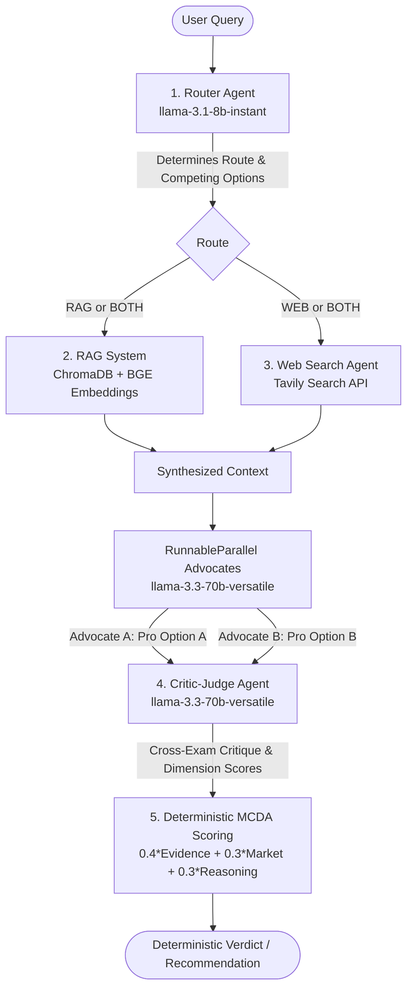

# ⚖️ Decision Debater AI — Project Guide & Reference

This document serves as a comprehensive reference guide to understand and remember the architecture, inner workings, and engineered solutions of the **Decision Debater AI** project.

---

## 1. Core Paradigm: Problem & Solution

### The General Problem
When individuals or organizations face complex decisions (e.g., *"Should I stay at my corporate job or join an early-stage AI startup?"*), standard LLMs fall short:
- **Confirmation Bias**: Conversational models tend to validate the user's assumptions or give agreeable, non-committal advice.
- **Linear Reasoning**: Single-turn prompt structures fail to systematically analyze trade-offs, ignoring alternative outcomes or hidden risks.
- **Context Gap**: Models lack grounding in proprietary files (business reports, personal notes) and real-time market situations, resulting in outdated or generic reasoning.

### The System's Solution
Decision Debater AI implements a **structured multi-agent dialectical debate** that mimics human critical reasoning:



Alternatively, here is the text-based schematic representation:
```
                [ User Query ]
                      │
                      ▼
               1. Router Agent
             (Frame options & route)
                      │
                      ├───────────────────────┐
                      ▼                       ▼
               2. RAG System          3. Web Search Agent
              (Chroma + BGE)           (Tavily API)
                      │                       │
                      └───────────┬───────────┘
                                  ▼
                            [ Context ]
                                  │
                      ┌───────────┴───────────┐
                      ▼                       ▼
             4. Option A Advocate    5. Option B Advocate
                 (Parallel LLM)          (Parallel LLM)
                      │                       │
                      └───────────┬───────────┘
                                  ▼
                              [ Arguments ]
                                  │
                                  ▼
                          6. Critic-Judge
                       (Critique & Scoring)
                                  │
                                  ▼
                       7. Deterministic MCDA
                     (Compute final winner)
```

1. **Routing & Option Framing**: Splits the query into two competing choices (`option_a` vs. `option_b`) and selects the retrieval strategy (RAG, Web, or Both).
2. **Grounding Context**: Queries ChromaDB (local documents) and Tavily (web data) to build a factual base.
3. **Parallel Advocates**: Two separate agent instances construct persuasive arguments for each choice concurrently.
4. **Critic-Judge Evaluation**: A central agent analyzes both arguments for flaws, biases, and risks, then scores each side on three separate dimensions.
5. **Deterministic Winner Selection**: Computes the final winner programmatically using weighted scoring rather than relying on LLM preferences.

---

## 2. Solved Engineering Challenges & Bug Fixes

During development, several platform-specific and package-compatibility issues were encountered and resolved. These fixes are preserved in [config.py](file:///c:/Users/muham/Documents/Projects/Decision%20Debater/config.py):

### A. Keras 3 / TensorFlow Backend Conflict
- **Issue**: Importing Hugging Face's `sentence-transformers` automatically triggers imports of TensorFlow/Keras libraries. If Keras 3 is installed in the system environment without `tf-keras`, imports break with a `RuntimeError` or `ModuleNotFoundError`.
- **Solution**: Explicitly restrict the backend to PyTorch by setting:
  ```python
  os.environ["USE_TF"] = "0"
  os.environ["USE_KERAS"] = "0"
  ```
  This skips loading any TensorFlow bindings and relies purely on the PyTorch execution backend.

### B. Windows OpenMP Duplicate Runtime Segfaults
- **Issue**: PyTorch (`MKL`/`libiomp`) and ChromaDB's ONNX Runtime each import their own OpenMP library threads. On Windows, loading both runtimes into a single process concurrently leads to memory access conflicts, resulting in intermittent segmentation faults or freezing during parallel thread calls.
- **Solution**: Allow duplicate runtimes and pin execution to a single thread:
  ```python
  os.environ["KMP_DUPLICATE_LIB_OK"] = "TRUE"
  os.environ.setdefault("OMP_NUM_THREADS", "1")
  ```
  This lets both runtimes co-exist safely on Windows.

### C. Tokenizer Thread Warnings
- **Issue**: Hugging Face Tokenizers automatically spawn sub-processes for parallel encoding. When invoked under LangChain's `RunnableParallel` threads (which execute the two advocates), the tokenizers trigger warning alerts concerning thread locks.
- **Solution**: Disabled tokenizers parallelism by setting:
  ```python
  os.environ.setdefault("TOKENIZERS_PARALLELISM", "false")
  ```

### D. Boot Order Guard
- **Issue**: Environment flags must be declared before *any* native C/C++ libraries are loaded in Python memory. If imports like `gradio`, `torch`, or `chromadb` occur before setting these flags, the settings are ignored and the app crashes.
- **Solution**: Enforce importing [config.py](file:///c:/Users/muham/Documents/Projects/Decision%20Debater/config.py) as the **first line** of the main entry point [app.py](file:///c:/Users/muham/Documents/Projects/Decision%20Debater/app.py).

---

## 3. Core Use Cases & Application Domains

Decision Debater AI is a general-purpose Multi-Agent Multi-Criteria Decision Analysis (MCDA) tool. Key target domains include:

| Domain | Option A vs. Option B Example | Grounding Context Used |
| :--- | :--- | :--- |
| **Career Decisions** | Corporate Job vs. Early-Stage AI Startup | Internal career portfolios, resumes, job reports vs. current industry stats. |
| **Technology Strategy** | Next.js App Router vs. Remix | Framework documentation, performance benchmarks, and real-time github stars/trends. |
| **Operations & Logistics** | Buy Equipment vs. Lease Equipment | Internal accounting sheets (RAG) vs. real-time market pricing and interest rates. |
| **Marketing Decisions** | Paid Ads vs. Organic Content Marketing | Historic performance tables (RAG) vs. current platform algorithms and CPM metrics (Web). |

---

## 4. Codebase Directory & Component Reference

The application contains the following directory files:

- **`docs/`**: The knowledge base. Sub-folders automatically map to metadata domains (e.g., `docs/career/` -> domain `"career"`, `docs/startup/` -> domain `"startup"`).
- [config.py](file:///c:/Users/muham/Documents/Projects/Decision%20Debater/config.py):
  - Sets up environmental variables and loads `.env` variables safely.
  - Declares model configurations: Llama models (`llama-3.3-70b-versatile`, `llama-3.1-8b-instant`), embeddings (`BAAI/bge-base-en-v1.5`), and rerankers (`BAAI/bge-reranker-base`).
  - Defines parameters for chunk sizes, search count parameters, and scoring weights.
- [retrieval.py](file:///c:/Users/muham/Documents/Projects/Decision%20Debater/retrieval.py):
  - Manages embeddings and instances of ChromaDB.
  - Implements `get_retriever()` which supports optional filtering by domain metadata and contextual reranking (using `ContextualCompressionRetriever`).
  - Performs Tavily Web search and runs `clean_web_results()` to strip HTML and extract clean bulleted snippets, reducing the token count sent to the LLM.
- [ingest.py](file:///c:/Users/muham/Documents/Projects/Decision%20Debater/ingest.py):
  - Scans `docs/` recursively.
  - Loads PDF, TXT, and Markdown files.
  - Tags chunk metadata with their folder name (`domain`).
  - Splits text using `RecursiveCharacterTextSplitter.from_tiktoken_encoder`.
  - Clears pre-existing vector store IDs to prevent duplicates and writes new embeddings in batches.
- [agents.py](file:///c:/Users/muham/Documents/Projects/Decision%20Debater/agents.py):
  - Constructs LLM chains with structured outputs using Pydantic schemas.
  - Defines `frame_query(query)` to parse inputs.
  - Sets up the `advocate_chain()` to generate bulleted pro/con arguments.
  - Instantiates `critic_judge()` which returns a critique, dimension scores, and reasoning.
  - Implements defensive fallbacks: if the LLM output violates the Pydantic format or hits api issues, it catches the exception and returns a neutral verdict fallback object instead of crashing.
- [pipeline.py](file:///c:/Users/muham/Documents/Projects/Decision%20Debater/pipeline.py):
  - Orchestrates the full query pipeline step-by-step.
  - Uses LangChain's `RunnableParallel` to execute the two advocates concurrently on separate CPU threads.
  - Implements deterministic scoring totals and tie-breaker rules.
- [app.py](file:///c:/Users/muham/Documents/Projects/Decision%20Debater/app.py):
  - Builds the UI via Gradio Blocks using custom theme configurations.
  - Contains generators that yield updates in real-time (yielding loading skeleton UI structures before returning final computations).
  - Wired to handle rate limits (429 errors) and network failures gracefully.
- [components.py](file:///c:/Users/muham/Documents/Projects/Decision%20Debater/components.py):
  - Houses all raw HTML elements, skeleton cards, and CSS indicators.
- [styles.css](file:///c:/Users/muham/Documents/Projects/Decision%20Debater/styles.css):
  - Standard CSS containing styling values, layouts, score bars, and animations.

---

## 5. Detailed Agent Specifications

The system utilizes three distinct agent setups, outlined below:

### A. Router / Framing Agent
- **LLM**: `llama-3.1-8b-instant` (Fast Model)
- **Role**: Extract target choices and routing path.
- **Pydantic Schema**:
  ```python
  class Framing(BaseModel):
      option_a: str = Field(description="First competing option, as a short label")
      option_b: str = Field(description="Second competing option, as a short label")
      route: Literal["RAG", "WEB", "BOTH"] = Field(description="Retrieval route: RAG, WEB, or BOTH")
  ```
- **Prompt**:
  > You analyze a user's decision question and identify the two competing options.
  > 
  > Question: {query}
  > 
  > Extract the two opposing options as short labels (option_a, option_b). If the question explicitly names two options, use them; otherwise infer the two most reasonable opposing choices.
  > Then choose a retrieval route:
  > - RAG: needs factual/historical knowledge from indexed documents
  > - WEB: needs current/real-time statistics or market data
  > - BOTH: needs both.

### B. Advocate Agent
- **LLM**: `llama-3.3-70b-versatile` (Reasoning Model)
- **Role**: Arguing single-sided positions based on grounding context.
- **Output**: Pure markdown string (4-6 evidence-driven bullet points).
- **Prompt**:
  > You are an expert advocate in a structured debate about: {option_a} vs {option_b}.
  > Argue persuasively and specifically IN FAVOR of: '{side}'.
  > 
  > Ground your argument in the context below and reference it where relevant. If the context is empty or irrelevant, rely on well-established reasoning.
  > 
  > Context:
  > {context}
  > 
  > Provide 4-6 structured arguments as concise, evidence-driven bullet points.

### C. Critic-Judge Agent
- **LLM**: `llama-3.3-70b-versatile` (Reasoning Model)
- **Role**: Neutral cross-examiner and evaluator.
- **Pydantic Schema**:
  ```python
  class OptionScores(BaseModel):
      evidence_score: float = Field(ge=0, le=10, description="Support from indexed documents")
      market_score: float = Field(ge=0, le=10, description="Validation from real-world/web data")
      reasoning_score: float = Field(ge=0, le=10, description="Internal logical strength")

  class Verdict(BaseModel):
      critique: str = Field(description="Critique of both arguments: flaws, bias, missing risks")
      option_a_scores: OptionScores
      option_b_scores: OptionScores
      reasoning_summary: str = Field(description="Concise explanation of the trade-offs")
  ```
- **Prompt**:
  > You are a rigorous Critic-Judge in a structured decision debate about {option_a} vs {option_b}.
  > 
  > Argument FOR {option_a}:
  > {arg_a}
  > 
  > Argument FOR {option_b}:
  > {arg_b}
  > 
  > Grounding context that was available to both sides:
  > {context}
  > 
  > Tasks:
  > 1. critique: critically analyze BOTH arguments — logical flaws, bias, missing risks.
  > 2. Score EACH option from 0-10 on three dimensions:
  >    - evidence_score: support from the grounding documents/context
  >    - market_score: validation by real-world / market data
  >    - reasoning_score: internal logical strength and completeness
  > 3. reasoning_summary: concisely explain the key trade-offs.
  > Be objective and avoid favoring either side without justification.

---

## 6. Grounding & Scoring Mechanics

The pipeline handles scoring and decision-making deterministically to eliminate LLM hallucinations and random fluctuations in final decisions.

### A. Context Grounding Synthesis
Before the advocates generate arguments, the context text is prepared according to the routing choice:
- **RAG Context**: Loaded by matching text against BGE vector embeddings in ChromaDB, returning sources in the format: `[source_filename.pdf] Page content...`
- **Web Context**: Loaded via Tavily search queries. Raw search outputs are cleaned into a single overall summary paragraph, followed by a list of title-snippet lines: `- Source Title: snippet text...`
These context strings are compiled together in [pipeline.py](file:///c:/Users/muham/Documents/Projects/Decision%20Debater/pipeline.py) and supplied to both advocates.

### B. Weighted Scoring Rubric
The Critic-Judge scores each option $0-10$ across three fields. The final total score is calculated using weighted coefficients defined in [config.py](file:///c:/Users/muham/Documents/Projects/Decision%20Debater/config.py):
$$\text{Total Score} = (0.4 \times \text{Evidence}) + (0.3 \times \text{Market}) + (0.3 \times \text{Reasoning})$$

*Why these weights?*
- **Evidence (40%)**: Ensures decision outcomes are grounded in verified, uploaded knowledge files.
- **Market (30%)**: Integrates real-time web conditions.
- **Reasoning (30%)**: Accounts for internal structural logic and completeness.

### C. Strict Tie-Breaking Logic
To prevent stalemate outcomes (and guarantee a concrete winner), exact ties (where `Total A == Total B`) are broken using sub-score dimensions sequentially:
1. **Reasoning Score**: Option with higher reasoning strength wins.
2. **Evidence Score**: (If reasoning matches) Option with better data grounding wins.
3. **Market Score**: (If evidence matches) Option with better web/market backing wins.
4. **Option A**: (If all matches) Falls back to Option A to prevent a loop.

---

## 7. Operational Reference Commands

Keep these commands handy to manage or execute the codebase:

### Environment Setup
Initialize the directory and download requirements:
```bash
pip install -r requirements.txt
cp .env.example .env
# Edit .env and enter GROQ_API_KEY and TAVILY_API_KEY
```

### Context Document Ingestion
Drop any `.pdf`, `.txt`, or `.md` files in `docs/` (or create subfolders like `docs/career/` and `docs/startup/` to register metadata domains) and index them:
```bash
python ingest.py
```
*(Note: re-running this automatically clears the old collection and indexes a clean set of documents).*

### Run the Web Interface
Launch the Gradio server:
```bash
python app.py
```
Open a browser and navigate to: `http://localhost:7860`
